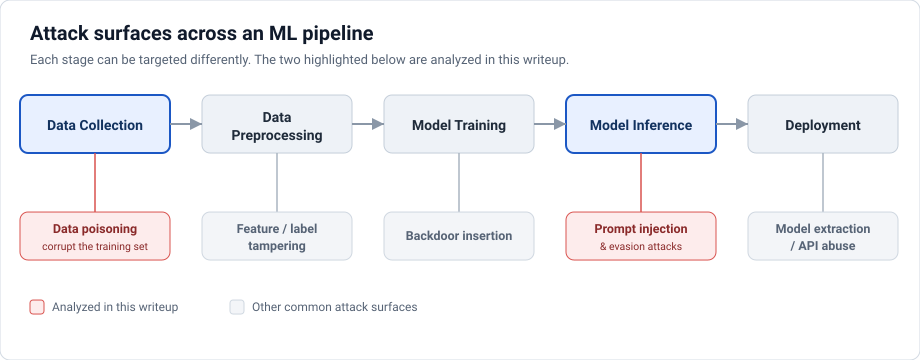

# AI/ML Security Threats

**Based on:** TryHackMe "AI and ML Security Threats" room

## Goal
Analyze the attack surface that AI/ML systems introduce — the points in the
pipeline an adversary can target that don't exist in traditional software.

## The ML pipeline
Data collection → preprocessing → model training → inference → deployment. Each
stage is a potential target.

## Components I analyzed

### Data Collection
- **Why it matters:** the foundation of the system. "Garbage in, garbage out" —
  the integrity of the training data directly sets the model's accuracy.
- **Vulnerability:** *data poisoning* — an attacker injects manipulated, biased,
  or malicious samples into the training set.
- **Attacker behavior:** tampering with public data sources the model scrapes,
  or submitting mislabeled content to systems that learn from user feedback.

### Model Inference
- **Why it matters:** the live stage where the model delivers value and users
  interact with it.
- **Vulnerability:** *input manipulation* — crafted inputs that exploit the
  model's learned patterns to force a chosen output.
- **Attacker behavior:** prompt injection (getting an LLM to ignore its rules)
  and evasion attacks (subtly altering malicious input so it's misclassified as
  safe).

## Scenario I wrote: poisoning an AI antivirus
An AV vendor trains its "clean software" model by scraping public code repos. An
attacker identifies those repos and uploads hundreds of harmless-looking programs,
each carrying a unique signature that also appears in the group's real malware.
The model learns to associate that signature with "safe." Later, the actual
malware ships with the same signature — the AV trusts it and lets it run. The
attack never breaks the model; it teaches the model to be wrong.

## Reflection
I used to think of AI/ML as a purely technical black box. This made "socio-
technical" concrete: the system depends on people at both ends — it learns from
data we create and is used by people trained to trust its output — so the
"socio" side is as exposed as the code.

What surprised me was how subtle the attacks are compared to buffer overflows or
SQL injection. Data poisoning corrupts the model's "brain" during training just
by feeding it bad data — not breaking the system, but making it learn to be
broken. Prompt injection is essentially social engineering aimed at the model:
you can subvert it with a clever sentence in plain English, no code required.

Defending these systems needs a different mindset — a zero-trust skepticism
toward both the training data and the model's outputs, plus the creativity to
think like an attacker. It's less about patching one bug and more about securing
the whole data pipeline and putting guardrails on the model's interactions.
